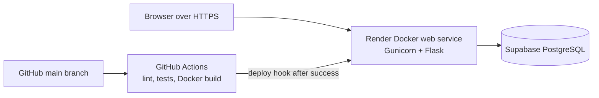
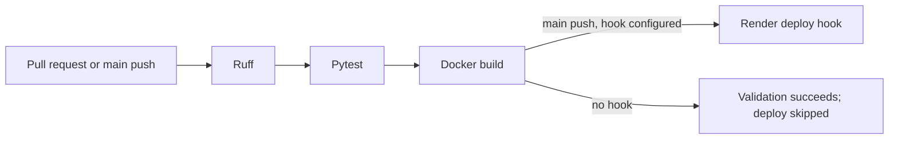

# CloudDesk

CloudDesk is a small IT helpdesk for a university or team. Students report Wi-Fi, hardware, software, and account problems as tickets; IT admins track the queue, resolve issues, and review service level status. It replaces scattered messages and spreadsheets with a persistent, searchable record.

## Features and stack

- User registration/login with hashed passwords and session cookies; CLI-only admin creation.
- Owner-scoped ticket creation, listing, detail, description edits, and status/priority/category filters.
- Admin status changes, activity history, aggregate dashboard cards, and Chart.js distributions.
- Illustrative 2/8/24-hour SLA for High/Medium/Low priority. UTC storage and IST display.
- JSON API with the same session, owner/admin rules, and CSRF protection as forms.
- Flask 3, SQLAlchemy, Flask-Login, Flask-WTF, Flask-Migrate/Alembic, Jinja2, locally bundled Bootstrap 5 and Chart.js, SQLite locally, PostgreSQL on Supabase, Gunicorn, Docker, GitHub Actions, Render, pytest, Ruff.

## Cloud architecture



Render is PaaS for the web service; Supabase is managed PostgreSQL. Locally, Docker can run the same app with SQLite in a named volume. Terraform and S3 are optional future enhancements and are not deployed here.

## Database ER diagram

```mermaid
erDiagram
  users ||--o{ tickets : creates
  users ||--o{ ticket_activities : performs
  tickets ||--o{ ticket_activities : records
  users { int id PK; string name; string email UK; string password_hash; string role; datetime created_at }
  tickets { int id PK; int user_id FK; string title; text description; string category; string priority; string status; datetime created_at; datetime updated_at; datetime resolved_at }
  ticket_activities { int id PK; int ticket_id FK; int actor_id FK; string action; string old_status; string new_status; datetime created_at }
```

Failed login attempts are stored separately as HMAC email digests and timestamps; they do not have a foreign key to users, so unknown email attempts receive the same limit.

## Local setup (Python 3.12)

PowerShell:

```powershell
python -m venv .venv
.\.venv\Scripts\python.exe -m pip install -r requirements-dev.txt
Copy-Item .env.example .env
# Edit .env: replace SECRET_KEY with a random value, e.g. from `python -c "import secrets; print(secrets.token_urlsafe(48))"`
.\.venv\Scripts\flask.exe --app run:app db upgrade
.\.venv\Scripts\flask.exe --app run:app create-admin
.\.venv\Scripts\python.exe run.py
```

Open <http://127.0.0.1:5000>. On macOS/Linux, activate the virtual environment and use `flask --app run:app ...` and `python run.py`. The app refuses to start without `SECRET_KEY`. The default SQLite database is `instance/clouddesk.db`. Use `flask --app run:app db migrate -m "description"` for model changes, inspect the generated revision, then run `db upgrade`. Production startup never calls `create_all()` or migrations automatically.

For deterministic local demo data, set two different local passwords of at least 12 characters and run:

```powershell
$env:DEMO_USER_PASSWORD = 'your-local-user-password'
$env:DEMO_ADMIN_PASSWORD = 'your-local-admin-password'
.\.venv\Scripts\flask.exe --app run:app seed-demo
```

This creates `aarav@example.test`, `mira@example.test`, and `admin@example.test` if absent, plus four tickets. Re-running keeps existing records and passwords. Only use these demo accounts locally; do not seed a public deployment. `create-admin` prompts for name, email, and a separate strong password.

## Docker

After putting `SECRET_KEY` in `.env`:

```powershell
docker compose build
docker compose run --rm web flask --app run:app db upgrade
docker compose run --rm web flask --app run:app create-admin
docker compose up -d
docker compose ps
```

Open <http://127.0.0.1:8000>. The `clouddesk_data` volume persists SQLite across container restarts. An **image** is the packaged app and dependencies; a **container** is a running instance of that image. Database migrations are a separate, explicit operation before startup. Use `docker compose logs web` for errors. Do not use `docker compose down -v` if you want to keep local records.

## CI/CD and cloud deployment



GitHub Actions uses read-only repository permissions and checks dependency advisories as well as lint, tests, and Docker build. Render `autoDeployTrigger: off` prevents an independent direct deploy from racing the validated deploy hook. CI has not run until a repository is pushed to GitHub. See [deployment instructions](docs/deployment.md) for Supabase connection choices, migrations, Render settings, health checks, recovery, and live verification.

## API

`GET /api/health` is public. `GET /api/tickets`, `POST /api/tickets`, `GET/PATCH /api/tickets/<id>`, and `GET /api/dashboard/stats` require the Flask login session. Users see only their tickets; only admins can change status. JSON writes use the cookie session and must send `X-CSRFToken`, obtained from the `<meta name="csrf-token">` tag after login. HTML forms use a hidden `csrf_token` field. The API does not issue long-lived bearer tokens.

Example browser JavaScript after login:

```js
fetch('/api/tickets', {
  method: 'POST',
  credentials: 'same-origin',
  headers: {'Content-Type': 'application/json', 'X-CSRFToken': document.querySelector('meta[name="csrf-token"]').content},
  body: JSON.stringify({title: 'Wi-Fi not working in Lab 301', description: 'No signal at desk 12', category: 'Network', priority: 'High'})
}).then(r => r.json()).then(console.log);
```

Responses use `{"ticket": ...}`, `{"tickets": [...]}`, `{"stats": ...}`, or `{"error": "..."}`. Creation returns 201; invalid input/CSRF 400; missing login 401 for API; forbidden 403; absent ticket 404; unexpected error 500 without a stack trace in the response.

## Security and testing

Passwords use Werkzeug hashing. Registration ignores submitted roles; ticket creation ignores submitted owner/status. ORM queries are parameterized. Login errors are generic. Five failed logins for the same normalized email in 15 minutes cause HTTP 429; failures are stored as HMAC email digests in the shared database, so the limit works across Gunicorn workers. It is a basic account limit, not a network-wide anti-abuse service; concurrent requests can slightly exceed the threshold. Cookies are HttpOnly and SameSite=Lax; Render forces Secure cookies and an allowed-host list. Secrets and local DB files are ignored by Git. Logout and all mutations require CSRF. On Render, startup refuses a missing PostgreSQL URL or a short secret.

```powershell
.\.venv\Scripts\ruff.exe check .
.\.venv\Scripts\python.exe -m pytest -q
.\.venv\Scripts\pip-audit.exe -r requirements.txt
.\.venv\Scripts\python.exe scripts\benchmark.py
.\.venv\Scripts\python.exe scripts\benchmark_http.py
```

The first benchmark uses 20 requests per operation against Flask's test client and temporary SQLite. The HTTP benchmark uses 10 requests per route through the local Docker/Gunicorn service and creates 10 clearly named local benchmark tickets. Neither measures internet or cloud latency. See [evaluation](docs/evaluation.md) for observed results, cost, and limits.

## Cost, limitations, future work

Local development costs no cloud fees. Render/Supabase free tiers, when available, have resource and sleep/pausing limits; verify current pricing and terms before creating an account. This MVP has no file attachments, notifications, password reset, audit export, queue pagination, or business-hours SLA. S3 and Terraform are deferred. Scaling vertically means a larger instance; horizontal scaling would need multiple stateless web replicas, a shared PostgreSQL database, and a load balancer. The local SQLite configuration is single-instance only.

The [case study](docs/case-study.md), [demo guide](docs/demo-guide.md), and [viva questions](docs/viva-questions.md) support the academic presentation.
